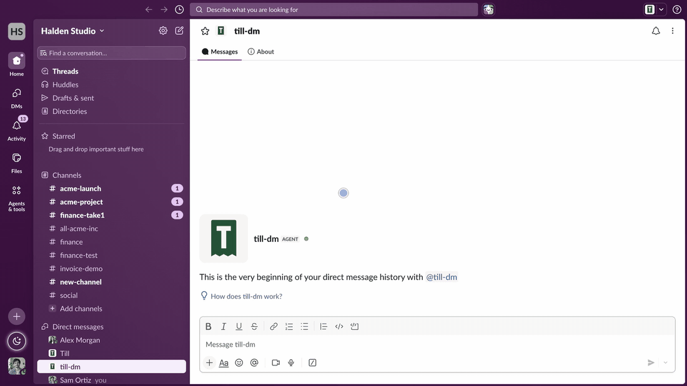
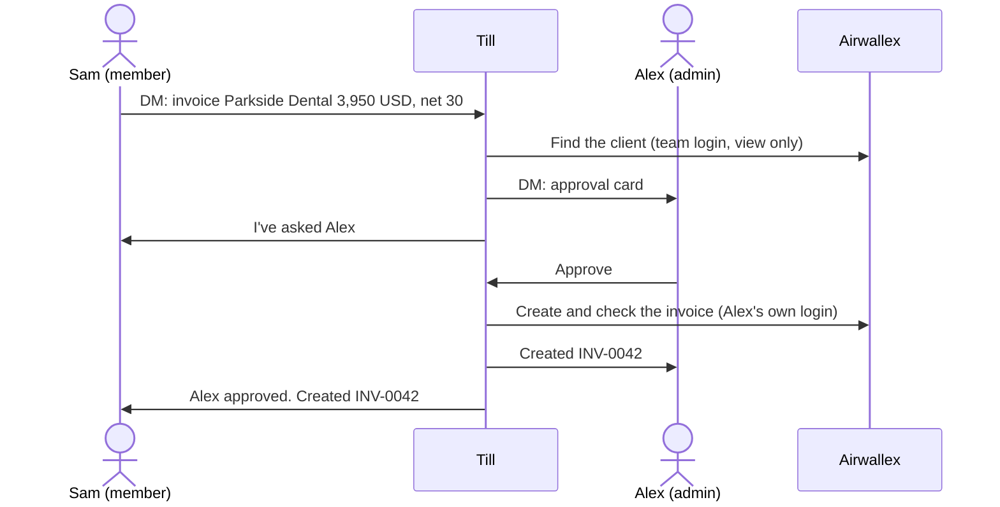

# Till in DMs

Till is a finance agent you message privately in Slack. People on the finance team DM `@Till` to ask
about balances or unpaid invoices. When one of them needs an invoice, Till sends the request to the
finance admins, and an admin approves it with one click.

Till reads and writes through the Airwallex MCP server. [Vercel Connect](https://vercel.com/docs/connect)
holds every login, to Slack and to Airwallex, so the project has no API keys or tokens of its own.



This is the direct-message version of [Till](https://github.com/Cyvid7-Darus10/till), which works in a
shared channel. In DMs, only the person who asked sees the answer.

```
DM: Sam and Till
  Sam   which invoices are overdue?
  Till  • Northwind Trading Ltd., EUR 6,200.00, due 2026-10-15, 1 day overdue
        Airwallex: team login

  Sam   invoice Parkside Dental 3,950 USD for the website redesign, net 30
  Till  I've asked @Alex to approve an invoice for Parkside Dental Group, USD 3,950.00.
        I'll message you here when it's decided.

DM: Alex and Till
  Till  [Invoice Parkside Dental Group]  Website redesign · USD 3,950.00 · Net 30
        Requested by Sam. Approving creates it with your own Airwallex login.
        (Approve) (Decline)
  Alex  presses Approve
  Till  Created invoice INV-0042 for Parkside Dental Group. Open invoice

DM: Sam and Till
  Till  Alex approved your request. Created invoice INV-0042 for Parkside Dental Group. Open invoice
```

## Who can do what

| Who | Airwallex login Till uses | What they can do |
| --- | --- | --- |
| A finance member | One shared team login, view only | Ask questions and request invoices in a DM |
| A finance admin | The admin's own login, connected the first time they approve | Everything a member can, plus approve or decline invoice requests |
| Anyone else | None | Nothing. Till replies that it only works with the finance team. |

Two settings define the team: `TILL_FINANCE_MEMBER_SLACK_IDS` and `TILL_FINANCE_ADMIN_SLACK_IDS`.
Admins count as members. If someone mentions `@Till` in a channel, Till asks them to send a DM instead
and shares nothing there.

Airwallex enforces the first limit. The team login is granted only view scopes, so Airwallex refuses
any write it attempts. Admin logins add the billing edit scopes and nothing else.

Till's code narrows the tools again (`lib/airwallex/tool-policy.ts`). With the team login, the model
sees only tools that Airwallex marks read-only. When it creates an invoice, it sees four tools: create
a product, create an invoice, add line items, finalize. Tools that move money (transfers, payouts,
conversions, simulations) are never loaded for any login.

## How an invoice request works



1. A member asks for an invoice in their DM. The model pulls out the client, amount, currency, terms
   and line item. The requester's name comes from Slack, never from the model.
2. Till's code, not the model, finds the Airwallex client. An exact name wins. Otherwise the name must
   be the start of exactly one client's name ("Parkside Dental" finds "Parkside Dental Group"). If no
   client or several clients match, Till stops and tells the requester.
3. Till sends an approval card to each admin's DM and tells the requester who it asked. If an admin
   asks for an invoice, the card goes only to that admin.
4. An admin presses Approve or Decline. The server checks that the clicker is an admin and that the
   button belongs to a card Till posted for this request. It then reads the cards back from Slack: if
   one has lost its buttons, someone already decided, and the click does nothing. The first decision
   closes every card.
5. On Approve, Till creates the invoice with the approving admin's own Airwallex login. If that admin
   has not connected Airwallex yet, Till sends them a sign-in button first, and creates the invoice as
   soon as they finish signing in. Until then, the cards keep their buttons, so another admin can
   still decide.
6. Till reads the invoice back from Airwallex and compares the client, currency, amount and status with
   what was approved. If anything differs, Till voids the invoice.
7. Till tells the admin and the requester the result, with a link to the invoice.

Every request has one Airwallex `request_id`, taken from the requester's Slack message, and Till tells
the model to use it. Airwallex treats a repeat with the same `request_id` as the same invoice, so a
double click, or two admins approving at once, should not create a second one. The model makes the
create calls, so this relies on it passing that id through; the read-back check catches a wrong client,
currency, amount or status, but not a wrong due date or line item.

The sign-in button's link back to Till is a short-lived token signed by
[Vercel KMS](https://vercel.com/docs/kms). It carries the approval, so following it creates the
invoice. The signing key never leaves Vercel, so the link cannot be forged, and it expires after 15
minutes. Before it creates anything, Till checks again that the approver is still an admin and that
the cards are still open, so the link does nothing once the request is decided.

To take someone's access away, remove them from the member or admin list and redeploy. To cut off an
admin's Airwallex access at once, revoke their grant in Vercel Connect.

## Privacy

Answers stay in the DM of the person who asked. Approval cards go only to admins. Even so:

- Every member can read everything the shared team login can see: balances in every currency, every
  client, and every invoice with its amount and due date. Add only people who may see company finances.
- Slack keeps DMs. Workspace owners on plans with exports or legal holds may be able to read them.
- Grant the team login only the view scopes in `lib/airwallex/tool-policy.ts`. Remove a scope there,
  for example balances, if members should not see that data.
- Keep the admin list short. Each admin can create invoices with their own login.
- To cut off access quickly, revoke the team login's grant in Vercel Connect. Till then answers that
  it has no access until an admin connects it again.

To report a security problem, see [SECURITY.md](SECURITY.md).

## Code tour

```
app/api/webhooks/slack/       Slack events and button clicks, verified by Vercel Connect
app/api/airwallex/connected/  The page the Airwallex sign-in returns to

lib/slack/        The conversation
  bot.ts            Answer a DM, send approval cards, decide, create
  cards.tsx         Replies, approval cards and sign-in buttons
  card-state.ts     Tells whether a card is still open (has its buttons)
  events.ts         Drops Slack's duplicate deliveries
  text.ts           Keeps names and model output from acting as Slack markup

lib/agent/        The model
  jobs.ts           Its two jobs: answer a DM, create one invoice
  instructions.ts   What it is told

lib/airwallex/    Access to Airwallex
  logins.ts         Whose login each job uses
  tool-policy.ts    Scopes and the tools the model may see
  session.ts        Opens the MCP server for one login
  login-link.ts     Signs and verifies the sign-in return link

lib/invoices/     The invoice itself
  request.ts        A request, its approval cards, and who may decide
  customer-match.ts Picks the one client an invoice is for
  check.ts          Reads the created invoice back and voids a mismatch

lib/config.ts     Every setting, validated at startup
lib/copy.ts       Every sentence Till says
lib/log.ts        One JSON line per log entry
```

Till keeps no database. A pending invoice travels inside the Slack buttons and the signed link, and
Till validates it again each time it comes back.

## Set it up

You need a Vercel team with Vercel Connect and Vercel KMS, a Slack workspace where you can install
apps, and an Airwallex sandbox account.

1. Deploy this repository to Vercel as a new project. It needs Node 22 or later.
2. In the project, open Connect and add a Slack connector named `slack/till-dm`. Turn on trigger
   forwarding to `/api/webhooks/slack` and install the app in your workspace.
3. Add an MCP connector for `https://mcp.sandbox.airwallex.com/developer` named
   `airwallex/till-sandbox`, or attach an existing one.
4. In Team Settings, open Key Management. Create an ES256 issuer, add a grant for this project and
   copy the issuer ID.
5. Set the two required environment variables, `TILL_KMS_ISSUER_ID` and
   `TILL_FINANCE_ADMIN_SLACK_IDS`, and list everyone else on the finance team in
   `TILL_FINANCE_MEMBER_SLACK_IDS`. Redeploy. `.env.example` lists every setting.
6. Send `@Till` a DM as an admin. The first time, Till sends you a button to connect the shared team
   login.

To fill an empty sandbox with three example clients and unpaid invoices, run `npm run seed`.

All settings live in `lib/config.ts`. The server checks them when it starts and refuses to run if a
required one is missing or invalid. None of them are secrets.

## Develop

```bash
npm install
vercel link
vercel env pull .env.local   # the OIDC token Vercel Connect needs, plus your settings
npm run dev
```

| Command | What it does |
| --- | --- |
| `npm run check` | Type check, lint, and tests with coverage |
| `npm run check-logins` | Lists which Airwallex logins are connected. It never prints tokens. |
| `npm run seed` | Adds example clients and invoices to an Airwallex sandbox |

Vercel Connect saves logins per environment. `check-logins` reports on the environment your
`.env.local` came from. Run `vercel env pull --environment production` to check production.

## Limits

- Till is built for an Airwallex sandbox. Review the scopes and the tool list before you point it at
  a live account.
- Till keeps no state between requests. It drops Slack's duplicate deliveries by message type, not by
  a stored ID. Add a state adapter such as Redis before you run several instances.
- The cards in Slack are the only lock. Two admins who press opposite buttons in the same second can
  both act. The shared `request_id` should still stop a second invoice.
- Till reads the last 20 messages of a DM for context, not a separate conversation per topic.
- At most five admins, because each approval card lists every card in its button value, and Slack
  limits that value's size. A request too long to fit is refused before any card goes out.
- The invoice check covers client, currency, amount and status. It does not check line items or the
  due date.
- Client lookup reads the first 100 Airwallex clients. With more than that, Till accepts only a
  client's full name, because a partial name could match the wrong client.
- Answers come from a model and can be wrong. Read the approval card before you press Approve.

## License

Apache License 2.0. If you use or adapt this code, keep the [NOTICE](NOTICE) file, which credits
Cyrus David Pastelero, as the license requires. See [LICENSE](LICENSE).
